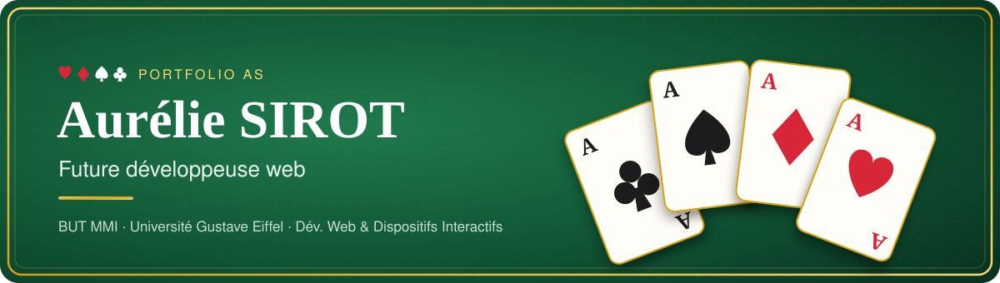

  

  

  
  
  

---

## ♥ As de Cœur — À propos

Étudiante en **2ᵉ année de BUT MMI** (Métiers du Multimédia et de l'Internet) à l'**Université Gustave Eiffel**, parcours **Développement Web et Dispositifs Interactifs**.

- 🛰️ Stagiaire développeuse **web / IHM** chez **Sodern** (filiale d'ArianeGroup), équipe Plateforme Viseurs et Caméras
- 📊 Développement de plugins de visualisation pour le framework **NASA OpenMCT** (HeatMap en Canvas 2D, Scatter Plot temps réel avec Plotly.js)
- ♿ Certifiée **Opquast** (800/1000) — qualité et accessibilité web
- 💃 Danseuse et bénévole associative, titulaire du **BAFA**

---

## ♦ As de Carreau — Mes atouts techniques

  

  
  
  
  
  

---

## ♠ As de Pique — Projets à la une

| | Projet | Description | Stack |
|:-:|---|---|---|
| ♦ | [**Blog Danse & Inspirations**](https://sirot.projetsmmichamps.fr/danse&inspiration/) | Mini-blog avec comptes, commentaires et back-office d'administration | PHP · MVC · SQL · Sessions |
| ♠ | [**CineGraph**](https://aurelie-s06.github.io/CineGraph/) | Visualisation interactive de données qui évoluent dans le temps | JS · Data Viz · Animations |
| ♥ | [**À table**](https://croustymap.roynajarian.fr/) | Plateforme participative pour trouver où manger selon son budget, son temps, son régime… | Fullstack · UX Research · Agile |
| ♣ | [**Web Inventory**](https://webinventory.sirot.projetsmmichamps.fr/) | Inventaire avec recherche, filtres et ajout sécurisé | PHP · MySQL · JS |
| ♦ | [**Aid'tudiants**](http://aidtudiants.fiol.projetsmmichamps.fr/) | Projet citoyen d'aide aux étudiants : site + communication complète | WordPress · Design · Motion |

  <a href="https://aurelie-as.familyds.com/projets.html"><b>→ Voir tous mes projets sur le portfolio</b></a>

---

## ♣ As de Trèfle — Mes stats

  
  

---

  <i>Chaque rencontre est une chance de créer — n'hésitez pas à me contacter !</i>  
  

♥ ♦ ♠ ♣

